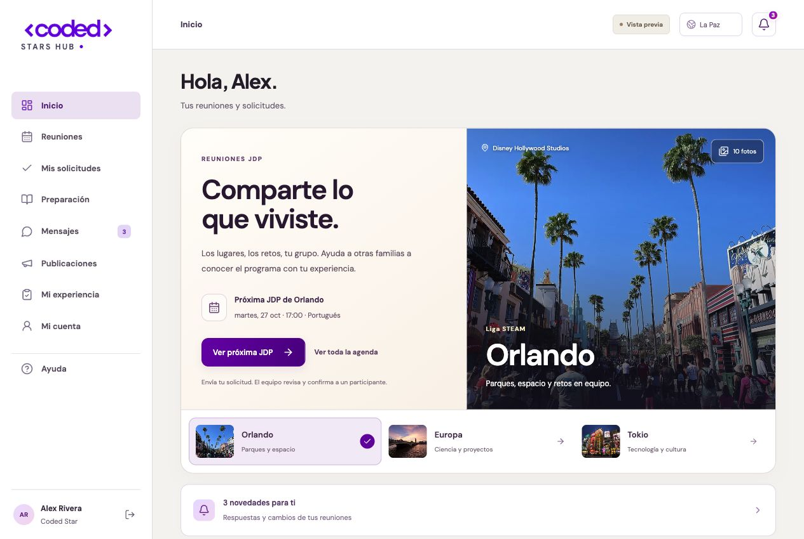
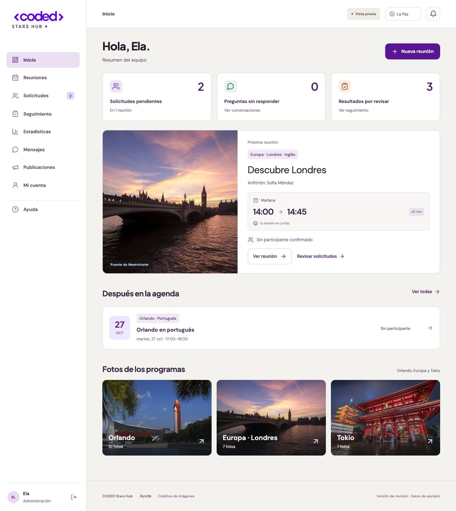
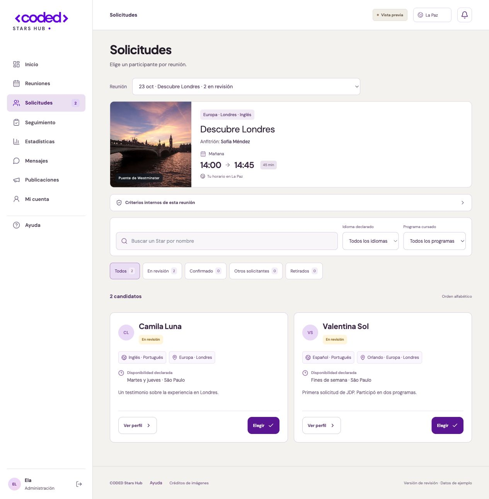

# CODED Stars Hub · Beta 1

Una primera versión para revisar con Isa y Ela: encontrar una JDP, solicitar participar y coordinar la selección de un Coded Star.

**Versión de revisión con datos ficticios y acceso personal para administración.** Las funciones del Hub siguen abiertas a comentarios del equipo.



## Para Isa y Ela

Abre la beta con tu correo y entra en **Revisión beta**. Allí puedes probar los tres perfiles en un espacio ficticio separado y registrar errores e ideas. No hace falta instalar nada.

- **[Guía de la beta privada](BETA-PRIVADA.md)**: acceso, pruebas y pendientes.

También se conservan los materiales de la primera presentación:

- **[Ver la presentación en PDF](docs/revision/Revision-CODED-Stars-Hub.pdf)**: recorrido por las pantallas principales.
- **[Guía del equipo](GUIA-EQUIPO.md)**: registrar reuniones, revisar solicitudes y publicar contenido.
- **[Proceso de las JDP](PROCESO-JDP.md)**: los cinco datos del calendario y las funciones propuestas para organizarlos.
- **[Recorrido de 7 minutos](PARA-MOSTRAR.md)**: una guía para presentar la versión.

**[Abrir la beta](https://coded-stars-beta.vercel.app/)** · Alojada en Vercel, con acceso personal y almacenamiento compartido. Este repositorio contiene el código y los materiales de revisión; las direcciones locales sirven solo para el desarrollo.

## Qué se puede probar en la plataforma

| Coded Star | Anfitrión | Coordinación |
| --- | --- | --- |
| Buscar reuniones y verlas en su zona horaria | Consultar sus reuniones y al Star confirmado | Registrar y editar las JDP |
| Solicitar participar y seguir su estado | Responder preguntas y agregar indicaciones | Revisar candidatos y elegir manualmente |
| Preparar su historia y preguntar al equipo | Cerrar una reunión y registrar su resultado | Publicar novedades y consultar seguimiento |
| Contar cómo fue su participación | Ver sus propios avisos | Administrar con perfiles separados de Isa y Ela |

Varias personas pueden solicitar la misma JDP. **Solo administración elige al participante y solo uno queda confirmado.** Si cancela, el equipo elige manualmente un reemplazo.

### Registrar una JDP

El formulario principal pide colegio, programa opcional, fecha, hora de Orlando y enlace de acceso. La zona original es **America/New_York**, con el cambio de horario de verano automático. El estudiante ve la hora convertida a la zona que eligió.

Idioma, anfitrión, duración e indicaciones están en opciones de coordinación. No se inventan datos cuando falta información.





## Ejecutar en una computadora

Requisitos: **Node.js 24** y **pnpm**.

```sh
pnpm install
```

Copia `.env.example` a `.env.local` y completa `SESSION_SECRET` con un valor aleatorio largo. Puedes generarlo con:

```sh
node -e "console.log(require('node:crypto').randomBytes(32).toString('hex'))"
```

Luego:

```sh
pnpm dev
```

Abre **http://localhost:3000**. La pantalla permite elegir Administración → Isa o Ela, Anfitrión o Coded Star. La contraseña de demostración es `Demo2026!`. Las cuentas son de prueba; no deben reutilizarse para información real.

Los datos locales se guardan en `.data/hub.sqlite`, fuera del código que se sube a GitHub. `CODED_DEMO_DB` permite usar otra ruta.

## Comprobaciones

```sh
pnpm test
pnpm typecheck
pnpm build
pnpm start
```

La revisión de esta versión incluye **211 comprobaciones unitarias**, **400 comprobaciones de servidor** y **24 comprobaciones de PostgreSQL compartido**, además de un recorrido en navegador por creación, solicitud, selección, acceso del anfitrión, cierre y resultado del Star. Los detalles y las condiciones de las pruebas están en **[VERIFICATION.md](VERIFICATION.md)**.

Las pruebas de servidor modifican datos: deben ejecutarse exclusivamente con una base de prueba independiente. Instrucciones completas en **[DETALLES-TECNICOS.md](DETALLES-TECNICOS.md)**.

## Acceso personal para la beta

Las cuentas personales se gestionan con Clerk. El servidor exige una sesión válida, un identificador del Hub asignado desde el servidor, el permiso registrado en metadatos privados y un correo verificado que coincida con el directorio privado. Los permisos enviados por el navegador no se utilizan.

Isa y Ela tienen asignados los perfiles de administración. Sus correos se configuran en variables privadas de Vercel; no forman parte del código. Sus direcciones se reservan al crear las cuentas y cada una debe verificar su correo en su primer acceso. No se genera una contraseña compartida.

`NEXT_PUBLIC_CODED_AUTH_MODE=clerk` activa la pantalla de acceso personal. La aplicación alojada en Vercel exige autenticación personal incluso si falta ese indicador. El acceso público de demostración queda deshabilitado en el servidor. El modo local de revisión conserva los perfiles ficticios.

Variables del acceso: `CLERK_SECRET_KEY`, `NEXT_PUBLIC_CLERK_PUBLISHABLE_KEY`, `CODED_ADMIN_ISA_EMAIL` y `CODED_ADMIN_ELA_EMAIL`. Configurarlas únicamente en el alojamiento o en archivos de entorno ignorados por Git. La instancia actual de Clerk es de desarrollo para la beta; no se presenta como una configuración de producción terminada.

El almacenamiento compartido usa PostgreSQL de Neon, con entornos separados para beta, vistas previas y pruebas. La aplicación alojada no utiliza el disco temporal para guardar reuniones. Consulta [BASE-COMPARTIDA.md](BASE-COMPARTIDA.md) para las migraciones y sus límites de escala. `CODED_BUILD_DIR` permite comprobar una compilación de acceso personal sin cambiar los archivos servidos por la demo local.

## Código y recursos

- `app/`: pantallas, componentes y rutas del servidor.
- `lib/`: permisos, reuniones, solicitudes, horarios y almacenamiento.
- `public/`: marca, fotografías y créditos.
- `tests/`: comprobaciones de lógica y de servidor.
- **[Detalles técnicos](DETALLES-TECNICOS.md)** y **[diseño](DISENO.md)**.
- **[Fuentes de marca](BRAND_SOURCES.md)** y **[créditos de fotografías](public/photo-credits.html)**.

Next.js, TypeScript y Tailwind. El asistente es una ayuda local basada en reglas y en los datos permitidos de cada cuenta; funciona sin API de pago y no es GPT.

## Antes de una publicación con usuarios reales

La demo local utiliza perfiles ficticios y SQLite. La beta alojada exige acceso personal y PostgreSQL compartido. Las notificaciones funcionan dentro del Hub; no se envían correos a los solicitantes.

Antes de pasar de esta beta a un uso de producción con datos reales, debe completarse la configuración de producción de Clerk y la revisión del equipo. El uso de datos reales de menores requiere autorización.

Esta revisión no implica la aprobación de CODED. Las fotografías ilustran lugares; no garantizan actividades de una edición concreta. Los créditos y derechos de marca se conservan en sus documentos de origen.

## Cierre de la beta privada

La sección **Cuentas** permite a administración preparar accesos privados de Stars y anfitriones, retomar altas y pausar o reactivar el acceso sin borrar el historial. En esta beta únicamente admite datos ficticios `@example.com`; no envía invitaciones. El directorio dinámico y sus correos se guardan en el servidor.

**Revisión beta** reúne la guía, las listas por rol y los aportes del equipo. Los recorridos de administración, anfitrión y Star están vinculados a la cuenta administradora y usan bases separadas por persona. El retorno a la cuenta real es explícito y las cuentas no se pueden administrar desde un recorrido.

Los avisos funcionan dentro del Hub. **Los correos externos quedan pendientes por decisión del titular** hasta disponer de un dominio remitente autorizado. Clerk sigue en modo de desarrollo. Consulta el alcance y la lista para la versión 1.1 en [BETA-PRIVADA.md](BETA-PRIVADA.md).

## Google Calendar

En **Mi cuenta**, cada persona puede preparar una agenda privada por URL para añadirla a Google Calendar. Los Stars exportan únicamente sus confirmaciones; anfitriones y administración reciben la agenda que les corresponde. Las actualizaciones se consultan desde el mismo enlace; se puede renovar o revocar. La adición en Google la realiza cada persona y sus intervalos de actualización dependen de Google. Esta exportación no comparte enlaces de Zoom ni datos de candidatos.

Administración también puede usar **Reuniones → Importar calendario** para revisar un `.ics` o una dirección iCal de Google autorizada. Elige las JDP antes de guardar, conserva los campos no informados y evita duplicados. No hay sincronización automática ni escritura en Google. Consulta [CALENDARIO.md](CALENDARIO.md).

El buscador de la barra superior abre las herramientas disponibles para cada perfil y las reuniones que ya puede consultar. También se abre con **Ctrl/⌘ + K** y se puede recorrer con flechas, Enter y Escape.

## Espacio del equipo

Está preparado un modo vacío y separado de los ejemplos para el trabajo de coordinación. No se activa con las claves de desarrollo ni sobre la base de la beta. Su activación requiere un dominio autorizado y Clerk de producción. Consulta [PRODUCCION.md](PRODUCCION.md).
